# Software Requirements Specification (SRS)

*MeraTrade Distribution – Expense Claim & Approval System*

# 1. Introduction

## 1.1 Purpose

This Software Requirements Specification (SRS) describes what MeraTrade Distribution's Expense Claim & Approval System must do. It defines the claim process, the business rules, the functional and non-functional requirements, the external interfaces and the data the system needs. It can guide a custom build or a fit-gap review of a commercial expense product (Appendix A).

The intended readers are the project sponsor and Finance, who confirm the rules; the delivery team, who design and build the system; and the testers, who prepare acceptance tests.

## 1.2 Scope

The system manages expense claims from creation and submission through approval, Finance review, accounting export and payment recording. Table 1 shows what the first release (MVP) includes and excludes.

*Table 1. Scope of the MVP*

<table>
<colgroup>
<col style="width: 64%" />
<col style="width: 35%" />
</colgroup>
<thead>
<tr class="header">
<th><strong>In scope (MVP)</strong></th>
<th><strong>Out of scope</strong></th>
</tr>
</thead>
<tbody>
<tr class="odd">
<td><ul>
<li>
Create claims with one or more expense lines and attach receipt files.
</li>
<li>
Check required data, receipts, spending limits and the submission deadline on submit.
</li>
<li>
Warn about potential duplicate expenses; Finance decides on each flagged line.
</li>
<li>
Route each claim to one or two approval levels based on its total.
</li>
<li>
Approve, return or reject; withdraw, cancel, correct and resubmit.
</li>
<li>
Finance review, CSV export to the accounting software and recording of the import result.
</li>
<li>
Record payments made outside the system.
</li>
<li>
Claim status, history and e-mail notifications.
</li>
<li>
A basic spending report.
</li>
<li>
Maintain categories, policy settings, employees and departments.
</li>
<li>
Role-based access to claims and actions.
</li>
</ul></td>
<td><ul>
<li>
Making payments or bank transfers.
</li>
<li>
Tax calculation and accounting compliance checks.
</li>
<li>
Cash advances, corporate cards and foreign currencies.
</li>
<li>
Reading receipts with OCR or AI.
</li>
<li>
Direct API integration and automatic HR synchronisation.
</li>
<li>
Building the company sign-in service (SSO).
</li>
<li>
Technical architecture and infrastructure.
</li>
<li>
A mobile app.
</li>
</ul></td>
</tr>
</tbody>
</table>

**Future scope (not in the MVP):** out-of-office approvers, reminders and escalation, re-routing open claims after a line-manager change, reassigning open claims of employees who leave, correcting a claim after it has been booked in accounting, and a warning when the same claim is edited in two windows.

## 1.3 Definitions, Acronyms, and Abbreviations

*Table 2. Definitions*

| **Term**                                      | **Meaning**                                                                                                                                                                                              |
|-----------------------------------------------|----------------------------------------------------------------------------------------------------------------------------------------------------------------------------------------------------------|
| **Claim**                                     | A request for reimbursement with one or more expense lines.                                                                                                                                              |
| **Claimant**                                  | The employee who creates and submits a claim.                                                                                                                                                            |
| **Expense line**                              | One expense in a claim: category, expense date, amount, description, optional invoice identifiers and any receipt files.                                                                                 |
| **First-submitted date**                      | The date a line was first submitted. A return, withdrawal or resubmission does not change it. Used for the late check.                                                                                   |
| **Approval route**                            | “Level 1 only” or “Level 1 + Level 2”. Set on each submission.                                                                                                                                           |
| **Current approval level / current approver** | Fields on the claim that show who must act next: the claimant’s line manager at Level 1, the Finance Manager at Level 2, or the person a level is re-routed to under BR-05. They are not claim statuses. |
| **Blocking issue**                            | A problem found on submit that stops the claim from being submitted. The full list is in FR-02.                                                                                                          |
| **Export batch**                              | A group of claims exported in one CSV file with a unique batch ID. The file is stored with the batch.                                                                                                    |
| **Export status**                             | A field, separate from claim status, that records what is known about the accounting import (§3.1.2).                                                                                                    |
| **Import result**                             | What Finance records after checking the accounting software: Imported, Rejected by accounting or Not imported.                                                                                           |
| **Potential duplicate**                       | A line that matches another line under BR-10. A match is a warning, not proof.                                                                                                                           |
| **Invoice identifiers**                       | Seller tax code, invoice symbol and invoice number of an invoice.                                                                                                                                        |
| **GL account code**                           | The accounting code of an expense category.                                                                                                                                                              |
| **Cost center code**                          | The accounting code of a department.                                                                                                                                                                     |
| **Policy settings**                           | Category receipt thresholds and limits, the submission deadline and the Level 2 threshold.                                                                                                               |
| **MoSCoW**                                    | Priority scale: Must, Should, Could, Won’t.                                                                                                                                                              |

*Table 3. Acronyms and ID prefixes*

| **Abbreviation** | **Meaning**                                    |
|------------------|------------------------------------------------|
| **AC**           | Acceptance criterion                           |
| **BR**           | Business rule                                  |
| **CSV**          | Comma-separated values: the export file format |
| **FR**           | Functional requirement                         |
| **GL**           | General ledger                                 |
| **MVP**          | Minimum viable product                         |
| **NFR**          | Non-functional requirement                     |
| **OQ**           | Open question                                  |
| **SSO**          | Single sign-on with the company account        |
| **UAT**          | User acceptance testing                        |
| **UC**           | Use case                                       |
| **US**           | User story                                     |
| **VND**          | Vietnamese dong; all amounts are in VND        |

## 1.4 References

Table 4 lists the public sources used for desk research and the standards and notations that shaped this document. They show common practice in expense tools. Using them is not a claim of conformance.

*Table 4. References*

| **No.** | **Source**                                                                                                                                                                                                                                          | **Used for**                                                                                                                                             |
|---------|-----------------------------------------------------------------------------------------------------------------------------------------------------------------------------------------------------------------------------------------------------|----------------------------------------------------------------------------------------------------------------------------------------------------------|
| 1       | [Zoho Expense Help – Configuring Approvals](https://www.zoho.com/au/expense/help/configuring-approvals/)                                                                                                                                            | Approval workflow                                                                                                                                        |
| 2       | [Zoho Expense FAQ – What is policy violation?](https://www.zoho.com/us/expense/kb/expenses/expense-policy-violation/)                                                                                                                               | Policy checks                                                                                                                                            |
| 3       | [Zoho Expense FAQ – Delegate vs Out-of-office Approver](https://www.zoho.com/us/expense/kb/delegation/difference-delegates-out-of-office-approver/)                                                                                                 | Future approval options                                                                                                                                  |
| 4       | [SAP Concur Community – “Easily Determine If I’ve Already Expensed An Item”](https://community.concur.com/t5/Concur-Expense-Forum/Easily-Determine-If-I-ve-Already-Expensed-An-Item/m-p/8083)                                                       | Duplicate warnings                                                                                                                                       |
| 5       | [Software Freedom Conservancy – Requirements for the Reimbursement System](https://f.sfconservancy.org/NPO-Accounting/npo-accounting-ikiwiki/src/commit/8018097f93b1e0b9a916dbf171605aef19f49d9d/Reimbursements/Requirements.mdwn) (commit 8018097) | Reimbursement requirements                                                                                                                               |
| 6       | [Karl E. Wiegers (TechTarget) – How to structure a software requirements document](https://www.techtarget.com/it-infrastructure/answer/How-to-structure-a-software-requirements-document), 19 Sep 2007                                              | SRS structure                                                                                                                                            |
| 7       | [ISO/IEC/IEEE 29148:2018 – Requirements engineering](https://www.iso.org/standard/72089.html)                                                                                                                                                       | Guide for the SRS outline and for writing each requirement as a “shall” statement with an ID and a priority. ISO lists a revised edition in preparation. |
| 8       | [ISO/IEC 25010:2023 – Product quality model](https://www.iso.org/standard/78176.html)                                                                                                                                                               | Checklist for choosing the quality concerns in chapter 4.                                                                                                |
| 9       | [OMG Unified Modeling Language (UML) 2.5.1](https://www.omg.org/spec/UML/2.5.1)                                                                                                                                                                     | Notation for the use case, activity and state diagrams in chapter 5.                                                                                     |

## 1.5 Overview

Chapter 2 describes the business context, users, environment and assumptions. Chapter 3 holds the claim lifecycle, the functional requirements, two use cases, the screens and the business rules. Chapter 4 covers quality requirements, chapter 5 the diagrams, chapter 6 the accounting export and other interfaces, chapter 7 the data model and chapter 8 how the requirements will be checked. The appendices hold the decision log and the open questions.

Related documents: the Elicitation Plan shows how the assumptions will be checked; the Product Backlog & Delivery Plan holds the user stories and acceptance criteria. This SRS is the source for the wording of requirements and business rules.

# 2. Overall Description

## 2.1 Product Perspective

### 2.1.1 Business Background

MeraTrade Distribution sells consumer goods to dealers and supermarkets in Vietnam. About 400 employees work in three offices: Da Nang (head office), Ha Noi and Ho Chi Minh City. Sales staff visit customers and travel between provinces. They pay for taxis, hotels, meals, client entertainment and small office purchases. The company uses an HR system for employee and reporting-line data, accounting software for bookkeeping and e-mail for communication.

Currently, employees fill in an Excel form and e-mail it with receipt photos to their manager, then hand paper receipts to Finance. Finance checks each claim, types it into the accounting software, pays outside the system and builds the monthly spending summary by hand.

### 2.1.2 Problem Statement

The current process depends on spreadsheets, e-mail and manual work. Employees cannot see where their claim is, so they ask Finance or their manager. Approval e-mails get lost among other messages, and the approval history is hard to trace. Receipt, limit, deadline and approval rules are applied unevenly, so many claims are returned. A receipt may be claimed twice without anyone noticing. Finance re-types approved claims into the accounting software and prepares the monthly summary by hand, which takes time and invites errors. These problems come from common practice and have not been confirmed for MeraTrade.

### 2.1.3 Business Objectives and Success Measures

The system aims to make claim status visible, apply the expense policy consistently, lower the risk of paying a duplicate and reduce Finance's manual work. Table 5 links each objective to a measure.

*Table 5. Business objectives and success measures*

| **Objective**            | **Success measure**                                                                                           |
|--------------------------|---------------------------------------------------------------------------------------------------------------|
| **Status visibility**    | Monthly status enquiries to Finance or managers; average calendar days from first submission to payment.      |
| **Consistent policy**    | Share of submitted claims returned for correction at least once.                                              |
| **Lower duplicate risk** | Potential duplicates found before payment, and confirmed duplicates found after payment, reported separately. |
| **Less Finance effort**  | Active Finance time to check and book one claim.                                                              |
| **Faster reporting**     | Time to prepare the monthly spending summary.                                                                 |

No baseline has been measured and no target has been set. Targets will be agreed after the baseline is measured (see the Elicitation Plan).

## 2.2 Product Functions

The system supports six groups of functions, specified in §3.1: claim creation and submission; approval routing and decisions; return, withdrawal and resubmission; Finance review with duplicate decisions; accounting export, import results and payment recording; and claim status, history, notifications, reporting and administration.

## 2.3 User Classes and Characteristics

All users are employees and can create, submit and track their own claims. Other permissions come from the user's system role and from being assigned as an approver, and they add up (§4.2). Each employee has one system role in the MVP; this is a BA recommendation for the case study. The CFO and HR depend on the system but do not use it.

*Table 6. User classes and stakeholders*

| **User class / stakeholder**  | **Responsibilities**                                                                                                                               | **Usage**                    |
|-------------------------------|----------------------------------------------------------------------------------------------------------------------------------------------------|------------------------------|
| **Employee (claimant)**       | Creates, submits and tracks own claims.                                                                                                            | A few times a month.         |
| **Line Manager**              | Approves at Level 1. Taken from the employee’s line-manager field, not a system role, so an employee with any system role can be a line manager.   | A few times a week.          |
| **Finance Manager**           | Approves at Level 2 (claims above the threshold), views the spending report and oversees the expense policy.                                       | Weekly.                      |
| **Finance Officer**           | Reviews claims and receipts, decides on potential duplicates, exports claims, records import results and payments. Never acts on their own claims. | Daily; main user.            |
| **System Administrator (IT)** | Maintains categories, settings, employees and departments. The role gives no access to other users’ claims and no Finance permissions (§4.2).      | When data or policy changes. |
| **CFO**                       | Sponsors the project and oversees company spending.                                                                                                | Stakeholder; no system use.  |
| **HR**                        | Owns employee, department and reporting-line data in the HR system.                                                                                | Stakeholder; no system use.  |

The claim form must stay simple for occasional users, while the Finance screens must handle daily volume.

## 2.4 Operating Environment

The system is an internal web application used through current desktop versions of Google Chrome and Microsoft Edge; a mobile layout is outside the MVP. Users sign in through the company sign-in service (SSO). Employee and department data come from the HR system but are entered in the expense system by the System Administrator. The system sends e-mails through the company e-mail service. Expense data reach the accounting software through CSV files that Finance downloads and imports by hand. Chapter 6 describes these interfaces.

## 2.5 Design and Implementation Constraints

The MVP must use the company's existing sign-in service and must pass expense data to the accounting software as CSV files. Direct API integration and automatic HR synchronisation are out of scope. The CSV layout must follow the accounting software's import template, which is not known yet. Payments are made outside the system, which only records them. Access must follow the role and reporting-line rules in §4.2. All amounts are in VND. This SRS does not prescribe a technical architecture or infrastructure.

## 2.6 Assumptions and Dependencies

The requirements rely on the assumptions below. If one proves wrong, the requirements that depend on it must be reviewed; the linked open question shows what is still to be confirmed.

### 2.6.1 Assumptions

- Users sign in with their company account through SSO, which is provided outside this system.

- The HR system is the source of employees, departments and line managers. The System Administrator keeps a copy in the expense system; how HR reports changes is open.

- The accounting software can import a CSV file, but its template is not known yet.

- The accounting software accepts or rejects all rows of a claim together. If it can book only some rows, Finance must reconcile them by hand.

- Finance pays outside the system, after the claim is booked in accounting, with one payment per claim.

- All amounts are in VND.

- About 400 employees use desktop browsers. The number of simultaneous users is not known.

- At least two Finance Officers are available, so that one can review, export, record the import result of and pay another's own claim. Exactly one active employee holds the Finance Manager role.

- Each employee has one system role. This is a BA recommendation for the case study (Appendix A), not a confirmed company rule.

- Claims already submitted by an employee who leaves can still be approved, exported and paid.

- Claims still in the Excel and e-mail process at go-live are finished there; new claims use the system from an agreed date.

### 2.6.2 Dependencies

- Employee, department and line-manager data must be loaded before UAT and kept up to date by the System Administrator.

- Finance must provide GL account codes for categories and cost center codes for departments before the first export.

- Finance and IT must provide the accounting import template and an example of an import result.

- The company sign-in and e-mail services must be available.

# 3. Specific Requirements

This chapter specifies the claim lifecycle, the functional requirements, two key use cases, the screens and the business rules. Functional requirements describe what the system does; the business rules hold the policy they apply.

## 3.1 Functional Requirements

Requirements are grouped by business capability. Each has an ID, a name, a description written as “shall” statements that names the business rules it applies, and a MoSCoW priority. Values in \[brackets\] come from the illustrative settings in §3.4.2. Each requirement FR-nn has a matching user story US-nn in the Product Backlog, so requirement IDs are not split or merged.

### 3.1.1 Claim Lifecycle

A claim is always in one of eight statuses (Table 7). The current approval level and current approver are fields on the claim, not statuses. Table 8 lists every allowed status change, with its actor and conditions; any other change is refused. The state diagram in §5.4 shows the same transitions.

*Table 7. Claim statuses*

| **Status**           | **Meaning**                                                     |
|----------------------|-----------------------------------------------------------------|
| **Draft**            | Being prepared by the claimant.                                 |
| **Pending Approval** | Waiting for the current approver (Level 1 or 2).                |
| **Returned**         | Sent back to the claimant for correction.                       |
| **Finance Review**   | All required approvals are done; waiting for a Finance Officer. |
| **Finance Verified** | Checked by Finance; ready for export (§3.1.2) and payment.      |
| **Paid**             | Payment recorded. Final.                                        |
| **Rejected**         | Closed without reimbursement. Final.                            |
| **Cancelled**        | Closed by the claimant. Final.                                  |

*Table 8. Claim status transitions*

| **From**          | **To**           | **Action**             | **Actor**                          | **Conditions**                                                                                                       | **Result**                                                                                                                 |
|-------------------|------------------|------------------------|------------------------------------|----------------------------------------------------------------------------------------------------------------------|----------------------------------------------------------------------------------------------------------------------------|
| Draft             | Pending Approval | Submit                 | Claimant                           | No blocking issue remains, including an active approver for each required level; any duplicate warning is confirmed. | Route set; Level 1 approver assigned; first-submitted date set on new lines; approver e-mailed.                            |
| Pending Approval  | Pending Approval | Approve (Level 1 of 2) | Current approver                   | The route needs Level 2, held by a different person.                                                                 | The Level 2 approver becomes the current approver and is e-mailed.                                                         |
| Pending Approval  | Finance Review   | Approve (last level)   | Current approver                   | Last required approval. If one person holds both levels, one approval completes both.                                | Claim listed for Finance; the history shows the level or levels approved.                                                  |
| Pending Approval  | Returned         | Return                 | Current approver                   | Comment entered.                                                                                                     | Claimant e-mailed with the comment.                                                                                        |
| Pending Approval  | Rejected         | Reject                 | Current approver                   | Comment entered.                                                                                                     | Claim closed; claimant e-mailed with the comment.                                                                          |
| Pending Approval  | Draft            | Withdraw               | Claimant                           | \-                                                                                                                   | Earlier approvals stay in the history but no longer count.                                                                 |
| Returned          | Pending Approval | Resubmit               | Claimant                           | Same as Submit.                                                                                                      | Checks, duplicate check and route recalculated; earlier duplicate decisions no longer apply; approval restarts at Level 1. |
| Draft or Returned | Cancelled        | Cancel                 | Claimant                           | \-                                                                                                                   | Claim closed and kept; claims are never deleted.                                                                           |
| Finance Review    | Finance Verified | Verify                 | Finance Officer (not the claimant) | Every flagged line has a decision and none is “Duplicate”.                                                           | Export status set to Not Exported.                                                                                         |
| Finance Review    | Returned         | Return                 | Finance Officer (not the claimant) | Comment entered.                                                                                                     | Claimant e-mailed with the comment.                                                                                        |
| Finance Review    | Rejected         | Reject                 | Finance Officer (not the claimant) | Comment entered.                                                                                                     | Claim closed; claimant e-mailed with the comment.                                                                          |
| Finance Verified  | Returned         | Return                 | Finance Officer (not the claimant) | Export status is Not Exported or Export Failed; comment entered.                                                     | Export status reset to Not Exported; claimant e-mailed.                                                                    |
| Finance Verified  | Paid             | Record payment         | Finance Officer (not the claimant) | Export status is Exported; payment date and reference entered (BR-12).                                               | Claim Paid; export status stays Exported; claimant e-mailed.                                                               |

Every transition adds a history entry. An action sent from an outdated screen, or sent twice, is refused without changing the claim.

### 3.1.2 Export Status

Claim status shows where a claim is in the business process. Export status is a separate field that records what is known about the accounting import, because generating a file does not mean that accounting has accepted it. It is used for Finance Verified and Paid claims. Recording an import result changes only the export status: the claim stays Finance Verified until it is paid or returned.

*Table 9. Export status values*

| **Export status**         | **Meaning**                                                                                                                 |
|---------------------------|-----------------------------------------------------------------------------------------------------------------------------|
| **Not Exported**          | Not in a batch yet, or reset after the claim was returned.                                                                  |
| **Awaiting Confirmation** | In a batch; no result recorded yet. The claim cannot be exported again, returned or paid.                                   |
| **Exported**              | Finance recorded that accounting accepted all rows of the claim. It stays Exported after payment.                           |
| **Export Failed**         | Finance recorded that no row of the claim was booked: accounting rejected it, or it was not imported. A reason is required. |

*Table 10. Export status changes (actor: a Finance Officer who is not the claimant)*

| **From**                      | **To**                | **Action**                                        | **Condition**                                                                                   |
|-------------------------------|-----------------------|---------------------------------------------------|-------------------------------------------------------------------------------------------------|
| Not Exported or Export Failed | Awaiting Confirmation | Generate export file                              | The claim is still eligible and has its accounting codes when the batch is saved.               |
| Awaiting Confirmation         | Exported              | Record “Imported”                                 | All rows of the claim were accepted.                                                            |
| Awaiting Confirmation         | Export Failed         | Record “Rejected by accounting” or “Not imported” | No row of the claim was booked: accounting rejected it, or it was not imported. Reason entered. |
| Export Failed                 | Not Exported          | Return the claim                                  | Comment entered; the claim becomes Returned.                                                    |

A partial import, where only some rows were booked, is not recorded as a result. The claim stays Awaiting Confirmation until Finance has reconciled it (§6.3).

### 3.1.3 Claim Creation and Submission

*Table 11. Functional requirements - Claim creation and submission*

<table>
<colgroup>
<col style="width: 7%" />
<col style="width: 15%" />
<col style="width: 68%" />
<col style="width: 8%" />
</colgroup>
<thead>
<tr class="header">
<th><strong>ID</strong></th>
<th><strong>Requirement</strong></th>
<th><strong>Description</strong></th>
<th><strong>Priority</strong></th>
</tr>
</thead>
<tbody>
<tr class="odd">
<td><strong>FR-01</strong></td>
<td>Create and edit a claim</td>
<td>
The system shall let an employee create a claim with one or more expense lines. The claim has a purpose field; whether it must be filled in before submission is open. A Draft may be saved without lines.

The claimant shall be able to attach one or more receipt files to any line. A receipt is required only where BR-02 says so; FR-02 checks this on submit.

The claimant shall be able to edit the claim and add, edit or remove lines only while the claim is Draft or Returned.
</td>
<td>Must</td>
</tr>
<tr class="even">
<td><strong>FR-02</strong></td>
<td>Check the claim on submit</td>
<td>
On submit and resubmit, the system shall check the claim against BR-01 to BR-03 and check that each required approval level has an active approver, using the settings in force at that moment. Over-limit and late lines shall be flagged.

Blocking issues<strong>:</strong> no expense line; missing or invalid line data; an inactive category; a missing required receipt; a flagged line without a justification; no active approver for a required level. Any blocking issue shall stop the submission. All issues, together with any duplicate warning, shall be shown at the same time, next to the field or line concerned.
</td>
<td>Must</td>
</tr>
<tr class="odd">
<td><strong>FR-03</strong></td>
<td>Warn about potential duplicates</td>
<td>
On submit and resubmit, the system shall check each line for potential duplicates and tell the claimant that a match exists, without showing the matched claim.

The duplicate confirmation (“Go back and edit” or “Submit anyway”) shall appear only when every blocking issue in FR-02 has been resolved. “Go back and edit” submits nothing; “Submit anyway” submits the claim. The flag, the matched claim and line, and the claimant’s choice shall be kept for approvers and Finance.
</td>
<td>Must</td>
</tr>
</tbody>
</table>

### 3.1.4 Approval Routing and Decisions

*Table 12. Functional requirements - Approval routing and decisions*

| **ID**    | **Requirement**           | **Description**                                                                                                                                                                                                                                                                                                                                                                                                                                                                                                                                        | **Priority** |
|-----------|---------------------------|--------------------------------------------------------------------------------------------------------------------------------------------------------------------------------------------------------------------------------------------------------------------------------------------------------------------------------------------------------------------------------------------------------------------------------------------------------------------------------------------------------------------------------------------------------|--------------|
| **FR-06** | Set the approval route    | On submit and resubmit, the system shall set the approval route with the Level 2 threshold in force at that moment, assign the Level 1 approver, apply BR-05 when an approver would be the claimant, and set the claim to Pending Approval. A required level without an active approver is a blocking issue; the message tells the claimant to contact the System Administrator.                                                                                                                                                                       | Must         |
| **FR-07** | Approve, return or reject | The system shall list for each approver the claims waiting for them, with lines, receipts, flags, justifications and, for a potential duplicate, the matched claim and line. Only the current approver shall be able to approve, return or reject, whatever their system role (§4.2), and never on their own claim. Approval at Level 1 of a two-level route shall make the Level 2 approver the current approver and e-mail them; approval at the last required level shall move the claim to Finance Review. Return and reject shall need a comment. | Must         |

### 3.1.5 Return, Withdrawal and Resubmission

*Table 13. Functional requirements - Return, withdrawal and resubmission*

| **ID**    | **Requirement**      | **Description**                                                                                                                                                                                                                                                                                                    | **Priority** |
|-----------|----------------------|--------------------------------------------------------------------------------------------------------------------------------------------------------------------------------------------------------------------------------------------------------------------------------------------------------------------|--------------|
| **FR-04** | Withdraw or cancel   | The system shall let the claimant withdraw a Pending Approval claim back to Draft, and cancel a Draft or Returned claim. After a withdrawal, an approver who opened the claim earlier shall no longer be able to act on it.                                                                                        | Should       |
| **FR-05** | Correct and resubmit | The system shall let the claimant open a Returned claim, read the comment, correct the claim and resubmit it. On resubmission the system shall repeat FR-02, FR-03 and FR-06 and restart approval at Level 1; earlier duplicate decisions no longer apply. Each existing line shall keep its first-submitted date. | Must         |

### 3.1.6 Finance Review and Duplicate Decisions

*Table 14. Functional requirements - Finance review and duplicate decisions*

<table>
<colgroup>
<col style="width: 7%" />
<col style="width: 15%" />
<col style="width: 68%" />
<col style="width: 8%" />
</colgroup>
<thead>
<tr class="header">
<th><strong>ID</strong></th>
<th><strong>Requirement</strong></th>
<th><strong>Description</strong></th>
<th><strong>Priority</strong></th>
</tr>
</thead>
<tbody>
<tr class="odd">
<td><strong>FR-08</strong></td>
<td>Finance review</td>
<td>
The system shall list the claims in Finance Review with claimant, total and flags. For each line flagged as a potential duplicate, a Finance Officer shall record “Duplicate” or “Not a duplicate”.

Verify shall be available only when the duplicate decisions meet BR-10; otherwise the claim can only be returned or rejected with a comment. Verifying shall set the export status to Not Exported. A Finance Verified claim shall be returnable only while its export status is Not Exported or Export Failed.

Own claims: a Finance Officer shall not be able to record duplicate decisions on, verify, return or reject their own claim; another Finance Officer handles it.
</td>
<td>Must</td>
</tr>
</tbody>
</table>

### 3.1.7 Accounting Export and Import-Result Recording

*Table 15. Functional requirements - Accounting export and import results*

<table>
<colgroup>
<col style="width: 7%" />
<col style="width: 15%" />
<col style="width: 68%" />
<col style="width: 8%" />
</colgroup>
<thead>
<tr class="header">
<th><strong>ID</strong></th>
<th><strong>Requirement</strong></th>
<th><strong>Description</strong></th>
<th><strong>Priority</strong></th>
</tr>
</thead>
<tbody>
<tr class="odd">
<td><strong>FR-09</strong></td>
<td>Generate an export batch</td>
<td>
The system shall let a Finance Officer export claims to the accounting software as follows:

1. Selection: list the Finance Verified claims that are eligible for export, excluding the user’s own claims.

2. Re-check on save: when a batch is saved, check each selected claim again. A claim that is no longer eligible or lacks an accounting code shall be left out with the reason and keep its export status.

3. All-or-nothing save: save the batch (ID, creator, date and time, CSV file as in §6.1 and §6.2), the export status Awaiting Confirmation of each included claim and the history entries together or not at all.

4. Concurrent export: if two Finance Officers save batches that contain the same claim at the same time, add the claim to one batch only. The other request shall leave the claim out with the reason “No longer eligible: already in batch &lt;batch ID&gt;”; if no other selected claim remains, that request shall be refused with the same reason and no batch shall be created. The claim shall end with export status Awaiting Confirmation, one link to the saved batch and one export entry in its history.

5. Nothing eligible: if no selected claim is still eligible, create no batch.

6. File failure: if the file cannot be generated, show an error and save nothing.
</td>
<td>Must</td>
</tr>
<tr class="even">
<td><strong>FR-10</strong></td>
<td>Record the import result</td>
<td>
The system shall list the batches that contain claims Awaiting Confirmation, and shall let a Finance Officer download a batch file again without creating a batch or changing any status.

After checking the accounting software, the Finance Officer shall record one result per claim: “Imported”, “Rejected by accounting” or “Not imported”. The effect on the export status is defined in Table 10. The two failure results need a reason and mean that no row of the claim was booked. If the result is not known, or only some rows were booked, nothing shall be recorded and the claim stays Awaiting Confirmation (§6.3).

Who may record: only a Finance Officer shall record import results, and never for a claim they submitted, even when another Finance Officer exported it. Such a claim shall be shown in the batch without result options; another Finance Officer records its result. The System Administrator role shall give no access to batches or import results (§4.2).

Traceability: each recorded result shall be stored with the batch, the claim, the result, the reason, the user and the date and time, and shall add a history entry.
</td>
<td>Must</td>
</tr>
</tbody>
</table>

### 3.1.8 Payment Recording

*Table 16. Functional requirements – payment recording*

| **ID**    | **Requirement** | **Description**                                                                                                                                                                                                                                                                                                                                                        | **Priority** |
|-----------|-----------------|------------------------------------------------------------------------------------------------------------------------------------------------------------------------------------------------------------------------------------------------------------------------------------------------------------------------------------------------------------------------|--------------|
| **FR-11** | Record payment  | The system shall let a Finance Officer record the payment date and payment reference for a Finance Verified claim that meets BR-12 and is not their own. The claim shall become Paid, keep the export status Exported and keep its link to the batch in which it was recorded as Imported. The claimant shall be e-mailed. A repeated payment action shall be refused. | Must         |

### 3.1.9 Claim Status, History and Notifications

*Table 17. Functional requirements – claim status, history and notifications*

<table>
<colgroup>
<col style="width: 7%" />
<col style="width: 15%" />
<col style="width: 68%" />
<col style="width: 8%" />
</colgroup>
<thead>
<tr class="header">
<th><strong>ID</strong></th>
<th><strong>Requirement</strong></th>
<th><strong>Description</strong></th>
<th><strong>Priority</strong></th>
</tr>
</thead>
<tbody>
<tr class="odd">
<td><strong>FR-12</strong></td>
<td>Claim status and history</td>
<td>
The system shall show users the claims they may access (§4.2), with status, total and current approver. For Finance Verified and Paid claims, the claim list and details shall also show the export status and the latest batch ID with its result; for a Paid claim this is the batch in which it was recorded as Imported.

The history shall record every status change, approval decision, duplicate decision, export, import result and payment, with user, date and time, and the comment or reason. Export and import-result entries shall also show the batch ID, so every batch a claim was in, with its result, is visible in the claim history.
</td>
<td>Must</td>
</tr>
<tr class="even">
<td><strong>FR-13</strong></td>
<td>E-mail notifications</td>
<td>The system shall e-mail the approver when a claim is assigned to them at Level 1 or Level 2, and the claimant when a claim is returned, rejected or paid, with the comment or the payment date. E-mails shall be sent after the action is saved. If sending fails, the action shall stay saved and the failure shall be logged for IT; there is no automatic retry. The Must priority is provisional (Appendix A).</td>
<td>Must</td>
</tr>
</tbody>
</table>

### 3.1.10 Spending Report and Administration

*Table 18. Functional requirements – spending report and administration*

| **ID**    | **Requirement**                    | **Description**                                                                                                                                                                                                                                                                                                                                                                                                                                                                                                                                                                  | **Priority** |
|-----------|------------------------------------|----------------------------------------------------------------------------------------------------------------------------------------------------------------------------------------------------------------------------------------------------------------------------------------------------------------------------------------------------------------------------------------------------------------------------------------------------------------------------------------------------------------------------------------------------------------------------------|--------------|
| **FR-14** | Spending report                    | The system shall let Finance Officers and the Finance Manager view total line amounts by department, category and expense month (by expense date) and download them as CSV. By default the report shall count Finance Review, Finance Verified and Paid claims; Pending Approval and Returned claims can be added. Draft, Rejected and Cancelled claims shall never be counted.                                                                                                                                                                                                  | Should       |
| **FR-15** | Maintain categories and settings   | The system shall let the System Administrator maintain expense categories (name, GL account code, receipt threshold, limit per line, active flag), the submission deadline and the Level 2 threshold without code changes. Changes shall apply to claims submitted or resubmitted afterwards. A deactivated category shall not be offered on new lines; claims already submitted keep it while they are processed, and on resubmission BR-01 applies.                                                                                                                            | Must         |
| **FR-16** | Maintain employees and departments | The system shall let the System Administrator maintain employees (system role, department, line manager, active flag) and departments (name, cost center code, active flag). Each employee shall have exactly one system role; the System Administrator role shall give no Finance permissions (§4.2). A line-manager change shall apply to claims submitted afterwards; submitted claims keep their approver. Deactivating an employee shall block sign-in, new claims and new approver assignments, but shall not change claims already submitted; they can still be exported. | Must         |

### 3.1.11 Exception Handling (MVP)

Table 19 lists the exceptions that change the normal flow or need a manual workaround. Blocking issues and duplicate warnings on submit (FR-02, FR-03), actions sent from an outdated screen or sent twice (NFR-04) and e-mail failures (FR-13) are specified in those requirements and are not repeated here.

*Table 19. Exceptions handled in the MVP*

| **Situation**                                                                      | **Expected behaviour**                                                                                                                                                                                                                       |
|------------------------------------------------------------------------------------|----------------------------------------------------------------------------------------------------------------------------------------------------------------------------------------------------------------------------------------------|
| A required level has no active approver.                                           | A blocking issue on submit; the claimant is told to contact the System Administrator.                                                                                                                                                        |
| An approver would be the claimant.                                                 | That level goes to the claimant’s line manager; one approval completes both levels if one person holds both. Provisional until OQ-01 is answered.                                                                                            |
| The approver leaves while a claim waits for them.                                  | No automatic reassignment. The System Administrator sets an active line manager; the claimant withdraws and resubmits the claim, so the route is recalculated and earlier approvals no longer count. This relies on FR-04, which is a Should |
| The claimant leaves.                                                               | Submitted claims continue to approval, export and payment. Draft and Returned claims stay open.                                                                                                                                              |
| A Returned claim uses a category that was deactivated after it was submitted.      | Resubmission is blocked until the claimant chooses an active category.                                                                                                                                                                       |
| A selected claim is no longer eligible or lacks an accounting code.                | It is left out of the batch with the reason; the others are exported.                                                                                                                                                                        |
| Two Finance Officers export the same claim at the same time.                       | The claim is saved in one batch only; the other user is told which batch holds it.                                                                                                                                                           |
| A Finance Officer’s own claim is in a batch that another Finance Officer exported. | They see the claim without result options; another Finance Officer records its import result.                                                                                                                                                |
| The export file cannot be generated, or a download fails.                          | Generation: an error is shown and nothing is saved. Download: the stored file is downloaded again; no new batch is created.                                                                                                                  |
| Accounting rejects the claim, or it was not imported.                              | Export Failed with a reason; export again in a new batch, or return the claim.                                                                                                                                                               |
| The import result is not known, or only some rows were booked (partial import).    | Nothing is recorded. The claim stays Awaiting Confirmation and cannot be exported again, returned or paid until Finance has reconciled it.                                                                                                   |
| An Exported claim is found to be wrong.                                            | It cannot be returned or put on hold in the system; Finance corrects it outside the system. How a booked entry is corrected is open.                                                                                                         |

## 3.2 Use Case Specifications

Table 20 lists the use cases shown in the use case diagram (§5.2). UC-01 and UC-05 are described in detail because they cover the main submission flow and the accounting export, where most exceptions occur. The other use cases are covered by the functional requirements and the diagrams in chapter 5.

*Table 20. Use cases*

| **ID**    | **Use case**                            | **Primary actor**                |
|-----------|-----------------------------------------|----------------------------------|
| **UC-01** | Submit Expense Claim (§3.2.1)           | Employee                         |
| **UC-02** | Withdraw or Cancel Claim                | Employee                         |
| **UC-03** | Review Claim as Approver                | Line Manager, Finance Manager    |
| **UC-04** | Review Claim as Finance                 | Finance Officer                  |
| **UC-05** | Export Claims to Accounting (§3.2.2)    | Finance Officer                  |
| **UC-06** | Record Payment                          | Finance Officer                  |
| **UC-07** | View Claim Status and History           | All users                        |
| **UC-08** | View Expense Report                     | Finance Officer, Finance Manager |
| **UC-09** | Maintain Categories and Policy Settings | System Administrator             |
| **UC-10** | Maintain Employees and Departments      | System Administrator             |

E-mail notifications (FR-13) are sent by the system within these use cases.

### 3.2.1 UC-01 Submit Expense Claim

*Table 21. UC-01 Submit Expense Claim*

<table>
<colgroup>
<col style="width: 17%" />
<col style="width: 82%" />
</colgroup>
<thead>
<tr class="header">
<th><strong>Element</strong></th>
<th><strong>Content</strong></th>
</tr>
</thead>
<tbody>
<tr class="odd">
<td><strong>Goal</strong></td>
<td>Submit business expenses for approval and reimbursement.</td>
</tr>
<tr class="even">
<td><strong>Primary actor</strong></td>
<td>Employee (claimant).</td>
</tr>
<tr class="odd">
<td><strong>Supporting actors</strong></td>
<td>Assigned approver; company e-mail service.</td>
</tr>
<tr class="even">
<td><strong>Preconditions</strong></td>
<td>The claimant is signed in and active.</td>
</tr>
<tr class="odd">
<td><strong>Trigger</strong></td>
<td>The claimant has business expenses to claim.</td>
</tr>
<tr class="even">
<td><strong>Main flow</strong></td>
<td>
1. The claimant creates a claim and adds one or more expense lines, attaching receipt files where needed. The purpose field can be filled in; whether it is required is open.

2. The claimant selects Submit.

3. The system runs the submit checks and the duplicate check, and finds no blocking issue and no potential duplicate.

4. The system sets the approval route and assigns the Level 1 approver.

5. The system sets the claim to Pending Approval, records the submission and e-mails the Level 1 approver.
</td>
</tr>
<tr class="odd">
<td><strong>Alternative flows</strong></td>
<td>
1a. Save draft: the claimant saves the claim as Draft and submits it later.

3a. Blocking issues: nothing is submitted and all issues are shown together (FR-02). The claimant fixes them and selects Submit again; the flow restarts at step 3.

3b. Potential duplicate and no blocking issue: the claimant confirms or goes back to edit (FR-03). “Submit anyway” continues at step 4, and the flag stays.

4a. Claimant would be an approver: that level goes to the claimant’s line manager (BR-05).

Resubmit: the claimant corrects a Returned claim and continues from step 2; approval restarts at Level 1
</td>
</tr>
<tr class="even">
<td><strong>Exceptions</strong></td>
<td>No active approver for a required level: a blocking issue. A repeated or outdated submission: refused. E-mail failure: the submission stays saved</td>
</tr>
<tr class="odd">
<td><strong>Postconditions</strong></td>
<td>
Success: the claim is Pending Approval with a current approver; the submission and first-submitted dates are recorded.

Not submitted: the claim stays Draft or Returned.
</td>
</tr>
</tbody>
</table>

### 3.2.2 UC-05 Export Claims to Accounting

*Table 22. UC-05 Export Claims to Accounting*

<table>
<colgroup>
<col style="width: 17%" />
<col style="width: 82%" />
</colgroup>
<thead>
<tr class="header">
<th><strong>Element</strong></th>
<th><strong>Content</strong></th>
</tr>
</thead>
<tbody>
<tr class="odd">
<td><strong>Goal</strong></td>
<td>Pass verified claims to the accounting software without re-typing them, and record whether accounting accepted them.</td>
</tr>
<tr class="even">
<td><strong>Primary actor</strong></td>
<td>Finance Officer.</td>
</tr>
<tr class="odd">
<td><strong>Supporting actors</strong></td>
<td>Accounting software, used by Finance outside the expense system.</td>
</tr>
<tr class="even">
<td><strong>Preconditions</strong></td>
<td>At least one claim is Finance Verified with export status Not Exported or Export Failed, and it is not the Finance Officer’s own claim.</td>
</tr>
<tr class="odd">
<td><strong>Trigger</strong></td>
<td>Finance prepares claims for booking and payment.</td>
</tr>
<tr class="even">
<td><strong>Main flow</strong></td>
<td>
1. The Finance Officer opens the export screen and selects eligible claims.

2. The Finance Officer selects Generate.

3. The system checks each claim again, saves the batch and its CSV file, and sets the included claims to Awaiting Confirmation.

4. The Finance Officer downloads the file and imports it into the accounting software by hand.

5. The Finance Officer checks the result in the accounting software and records “Imported” for each accepted claim that is not their own; its export status becomes Exported.
</td>
</tr>
<tr class="odd">
<td><strong>Alternative flows</strong></td>
<td>
3a. Some claims fail the check, or none passes.

3b. Another Finance Officer exports the same claim at the same moment: the claim is saved in one batch only, and the user is told which batch holds it.

4a. Download fails: the stored file is downloaded again; no new batch is created.

5a. Rejected or not imported: the result is recorded with a reason; the claim becomes Export Failed and can be exported again or returned (Table 34).

5b. Result unknown or partial import: nothing is recorded; the claim stays Awaiting Confirmation (§6.3).

5c. A claim in the batch is the Finance Officer’s own: they cannot record its result; another Finance Officer does.
</td>
</tr>
<tr class="even">
<td><strong>Exceptions</strong></td>
<td>If the file cannot be generated, an error is shown and nothing is saved.</td>
</tr>
<tr class="odd">
<td><strong>Postconditions</strong></td>
<td>
Batch saved: included claims are Awaiting Confirmation and linked to the batch; left-out claims keep their export status.

Result recorded: accepted claims are Exported and can be paid; rejected or not-imported claims are Export Failed.
</td>
</tr>
</tbody>
</table>

## 3.3 GUI Requirements

The low-fidelity wireframes below show the key screens and states. They are low-fidelity desktop frames (1440 px wide). They clarify the requirements; the functional requirements and acceptance criteria remain the basis for behaviour and testing. The numbers in each figure refer to the notes under it. Names and values are test data.

### 3.3.1 Claim Form (Employee)

The claim form is shown in two states. In state A, the first Submit finds a blocking issue, so nothing is submitted. In state B, the claimant has attached the missing receipt and selected Submit again. Only the duplicate warning is left, so the system asks the claimant to confirm.

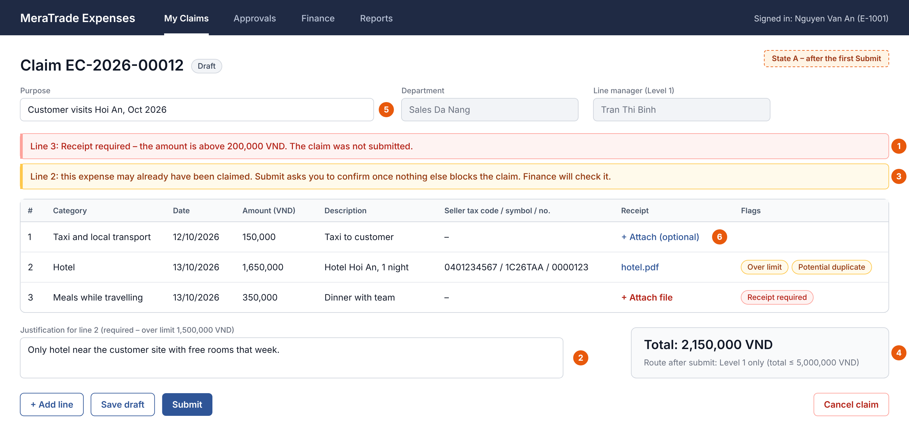

*Figure 1. Claim form, state A: after the first Submit (Employee)*

1\. A missing required receipt blocks submission; the message is on the line.

2\. An over-limit line needs a justification before the claim can be submitted.

3\. The duplicate warning appears with the other issues and only says that a match exists. “Submit anyway” is not offered while a blocking issue remains.

4\. The route preview uses the claim total and the line manager; the route is set at submission.

5\. Purpose is a claim field shown without a required marker; whether it is required is open.

6\. Line 1 is below the category’s receipt threshold, so a receipt may be attached but is not required.

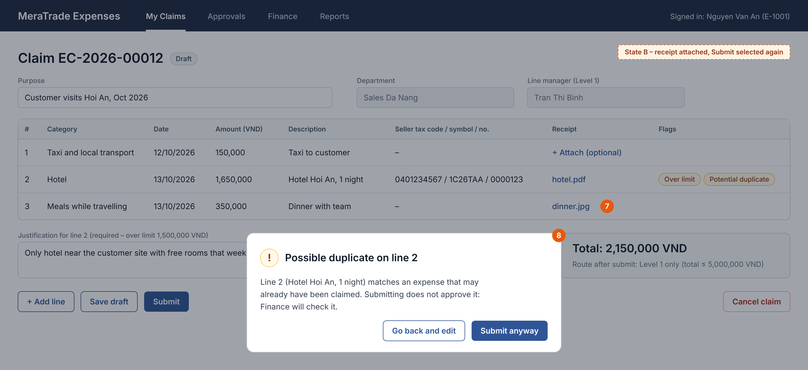

*Figure 2. Claim form, state B: receipt attached and Submit selected again (Employee)*

7\. Line 3 now has a receipt and line 2 has a justification, so nothing blocks the claim.

8\. Only now is the duplicate confirmation shown. “Go back and edit” submits nothing; “Submit anyway” submits the claim and the flag stays on line 2.

### 3.3.2 Claim Review (Approver and Finance Officer)

The approver and the Finance Officer review the same claim at different steps. The approver decides at the current level; the Finance Officer records the duplicate decisions and then verifies, returns or rejects the claim.

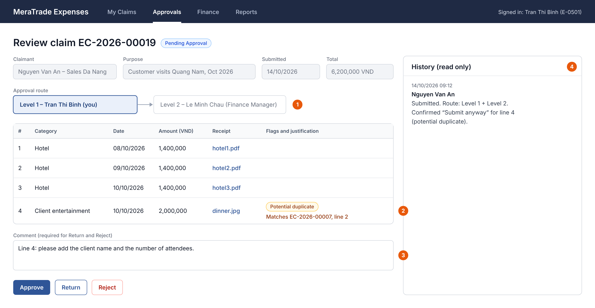

*Figure 3. Claim review (Approver)*

1\. The current level and approver are fields on the claim, not statuses. When Level 1 approves, the Level 2 approver becomes the current approver and is e-mailed.

2\. Approvers see flags, justifications and the matched claim and line.

3\. Return and Reject need a comment.

4\. The history is read-only and shows the claimant’s “Submit anyway” choice.

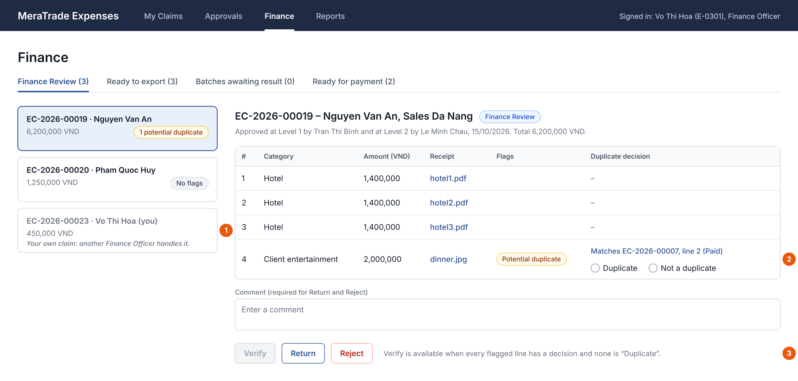

*Figure 4. Finance review (Finance Officer)*

1\. A Finance Officer’s own claim is listed but offers no Finance actions; another Finance Officer handles it.

2\. Each flagged line shows the matched claim and line and needs a decision: “Duplicate” or “Not a duplicate”.

3\. Verify stays disabled until every flagged line has a decision and none is “Duplicate”. Return and Reject need a comment.

### 3.3.3 Export - Before Generate (Finance Officer)

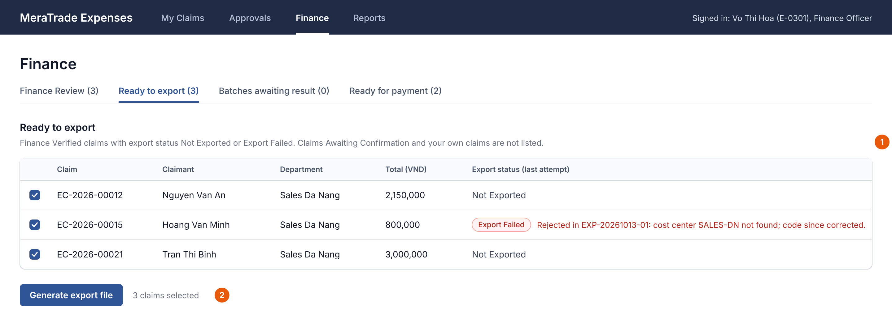

*Figure 5. Export screen before Generate (Finance Officer)*

1\. Only Finance Verified claims with export status Not Exported or Export Failed are listed. Claims Awaiting Confirmation and the user’s own claims are not.

2\. On Generate, each claim is checked again. A claim that another Finance Officer has just exported, or that lacks an accounting code, is left out with the reason.

### 3.3.4 Export – After Generate (Finance Officer)

After Generate, a Finance Officer records the import result for each claim in the batch, except their own claims. Payment is recorded on a separate tab, only for claims that are already Exported.

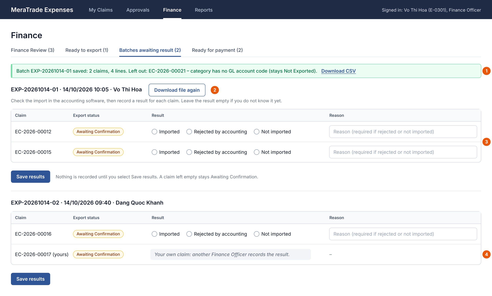

*Figure 6. Export screen right after Generate: batches awaiting result (Finance Officer)*

1\. The batch is saved. A claim that lacks an accounting code is left out with the reason and keeps its export status.

2\. Downloading the file again creates no batch and changes no status.

3\. No result is pre-selected. After checking the accounting software, Finance selects a result for each claim; nothing is recorded until Save results is selected. “Rejected by accounting” and “Not imported” need a reason; a claim left empty stays Awaiting Confirmation.

4\. A claim the user submitted is shown without result options, even though another Finance Officer exported it; another Finance Officer records its result.

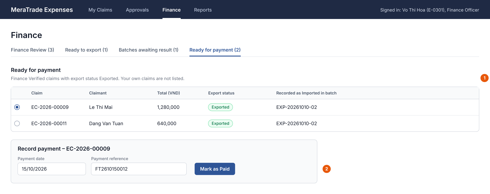

*Figure 7. Ready for payment tab (Finance Officer)*

1\. Only Finance Verified claims with export status Exported are listed, without the user’s own claims.

2\. Mark as Paid needs a payment date and a reference. The claim becomes Paid, keeps the export status Exported, and the claimant is e-mailed.

## 3.4 Business Rules

Business rules hold the policy that the functional requirements apply. Each rule is written once here, and other sections refer to it by ID. No rule has been confirmed by MeraTrade stakeholders. The last column names the open question that could change the rule.

### 3.4.1 Rules

*Table 23. Business rules*

<table>
<colgroup>
<col style="width: 7%" />
<col style="width: 12%" />
<col style="width: 79%" />
</colgroup>
<thead>
<tr class="header">
<th><strong>ID</strong></th>
<th><strong>Name</strong></th>
<th><strong>Rule</strong></th>
</tr>
</thead>
<tbody>
<tr class="odd">
<td><strong>BR-01</strong></td>
<td>Claim content</td>
<td>
A claim needs at least one expense line to be submitted; a Draft may have none. Each line has an active category, an expense date that is not in the future, a positive whole amount in VND and a description of up to [200] characters. Invoice identifiers are optional. Line numbers are unique within a claim and are not reused. The claim total is the sum of its lines. The claim has a purpose field; whether it must be filled in before submission is open, so it is not part of the submit checks until OQ-21 is answered.

Deactivating a category does not change claims already submitted: their lines keep it while the claim is processed. A Returned claim is checked again on resubmission (BR-09), so a line whose category has since been deactivated blocks resubmission until the claimant chooses an active category (proposal).
</td>
</tr>
<tr class="even">
<td><strong>BR-02</strong></td>
<td>Receipts</td>
<td>Each category has a receipt threshold. A line whose amount is above it must have at least one receipt file; otherwise submission is blocked. Receipt files may be attached to any line.</td>
</tr>
<tr class="odd">
<td><strong>BR-03</strong></td>
<td>Over-limit and late lines</td>
<td>A line above its category limit is flagged “Over limit”. A line is flagged “Late” when more than [30] days passed between its expense date and its first-submitted date. A flagged line needs a justification; the claim can still be submitted, and approvers see the flag. The first-submitted date stays the same after a return, withdrawal or resubmission; a new line gets its own date; changing a line’s expense date recalculates the Late flag.</td>
</tr>
<tr class="even">
<td><strong>BR-04</strong></td>
<td>Approval route</td>
<td>Level 1 is the claimant’s line manager, whatever that person’s system role. Level 2 (the Finance Manager) is added when the claim total is above [5,000,000 VND]. The threshold is checked per claim, not across related claims. The route is set on each submission.</td>
</tr>
<tr class="odd">
<td><strong>BR-05</strong></td>
<td>No action on own claims</td>
<td>Nobody acts on their own claim as an approver or as a Finance Officer: nobody approves, returns, rejects or verifies their own claim, records a duplicate decision or an import result on it, exports it or records its payment, even when another person did the earlier step. If an approver would be the claimant, that level goes to the claimant’s line manager. If both levels end up with the same person, one approval completes both. Another Finance Officer handles a Finance Officer’s own claim. Approvers must be active employees. If a user’s permissions conflict, the action is refused (BA recommendation, Appendix A).</td>
</tr>
<tr class="even">
<td><strong>BR-06</strong></td>
<td>Comments</td>
<td>Return and reject need a comment. The claimant sees it in the history and in the e-mail.</td>
</tr>
<tr class="odd">
<td><strong>BR-07</strong></td>
<td>Edit, withdraw and cancel</td>
<td>Only the claimant edits a claim and its lines, and only while it is Draft or Returned. Withdrawing a Pending Approval claim takes it back to Draft; earlier approvals stay in the history but no longer count. Draft and Returned claims can be cancelled. Claims are never deleted.</td>
</tr>
<tr class="even">
<td><strong>BR-08</strong></td>
<td>Resubmission</td>
<td>A resubmitted claim restarts at Level 1. The checks, the duplicate check and the route are recalculated. Earlier duplicate decisions no longer apply but stay in the history.</td>
</tr>
<tr class="odd">
<td><strong>BR-09</strong></td>
<td>Policy timing</td>
<td>The settings in force when a claim is submitted or resubmitted apply to it: the category active flag, receipt threshold and limit, the submission deadline and the Level 2 threshold. A later change does not re-check claims already submitted; they keep their route and flags until they are resubmitted.</td>
</tr>
<tr class="even">
<td><strong>BR-10</strong></td>
<td>Potential duplicates</td>
<td>
On submit and resubmit, each line is compared with the other lines of the same claim and with lines of other claims in any status except Rejected and Cancelled, including Draft and Returned claims (proposal). Check A: same seller tax code, invoice symbol and invoice number, applied only when all three are filled. Check B: same claimant, expense date, category and amount.

A match is a warning, not proof. The claimant is told only that a match exists; approvers and Finance see the matched claim and line. Which matches are shown when a line matches more than one line is open; until then one match is stored per line. Finance records a decision on each flagged line before verifying; a line marked “Duplicate” means the claim must be returned or rejected. Decisions are cleared on resubmission and stay in the history.
</td>
</tr>
<tr class="odd">
<td><strong>BR-11</strong></td>
<td>Export eligibility</td>
<td>Only Finance Verified claims with export status Not Exported or Export Failed can be exported. Eligibility and accounting codes are checked again when the batch is saved, so a claim is never in two open batches. Export Failed means that no row of the claim was booked; only then may the claim be exported again. A claim whose claimant has left can still be exported.</td>
</tr>
<tr class="even">
<td><strong>BR-12</strong></td>
<td>Payment</td>
<td>Payment can be recorded only when the export status is Exported. The payment date and reference are required. The system records the payment; it does not transfer money.</td>
</tr>
</tbody>
</table>

### 3.4.2 Illustrative Policy Settings

The values below are examples used by the wireframes and the test data. They are not company policy or real accounting codes.

*Table 24. Illustrative expense categories*

| **Category**             | **GL account code** | **Receipt needed above (VND)** | **Limit per line (VND)** |
|--------------------------|---------------------|--------------------------------|--------------------------|
| Taxi and local transport | 6418                | 200,000                        | No limit                 |
| Hotel                    | 6418                | 0 (always)                     | 1,500,000                |
| Meals while travelling   | 6418                | 200,000                        | 500,000                  |
| Client entertainment     | 6428                | 0 (always)                     | 3,000,000                |
| Office supplies          | 6428                | 200,000                        | 1,000,000                |
| Training fees            | (not set)           | 0 (always)                     | No limit                 |

*Table 25. Illustrative global settings*

| **Setting**         | **Illustrative value**          |
|---------------------|---------------------------------|
| Submission deadline | 30 days after the expense date  |
| Level 2 threshold   | Claim total above 5,000,000 VND |

# 4. Non-Functional Requirements

This chapter defines the quality requirements. ISO/IEC 25010:2023 was used as a checklist to choose the relevant quality concerns; this is not a claim of conformance. Each requirement has a priority and any open point. How each one will be checked is planned in Table 37. None has been tested.

## 4.1 Performance Efficiency Requirements

*Table 26. Performance requirements*

| **ID**     | **Quality concern**         | **Requirement**                                                                                                                  | **Priority** |
|------------|-----------------------------|----------------------------------------------------------------------------------------------------------------------------------|--------------|
| **NFR-07** | Performance (response time) | The My Claims, approval, Finance and export lists and the claim details shall open within \[3 seconds\] under normal office use. | Should       |

## 4.2 Security Requirements

*Table 27. Security requirements*

| **ID**     | **Quality concern**       | **Requirement**                                                                                                                                                                           | **Priority** |
|------------|---------------------------|-------------------------------------------------------------------------------------------------------------------------------------------------------------------------------------------|--------------|
| **NFR-01** | Security (access control) | The system shall enforce the permissions in Table 28 and Table 29 for viewing claims and performing actions. Other actions shall be refused, including requests sent outside the screens. | Must         |
| **NFR-02** | Security (sign-in)        | Users shall sign in with their company account through single sign-on (SSO).                                                                                                              | Must         |

Permissions add up. Every user has the claimant permissions for their own claims. A user who is assigned as an approver has the approver permissions for that claim, whatever their system role (Table 27). A system role adds the permissions in Table 29; in the MVP each employee has one system role. Line Manager is not a system role; it comes from the employee records.

*Table 28. Permissions from the user’s relationship to a claim*

| **Relationship**                                                                                                      | **Permissions**                                                                                                                                                              | **Applies to**                                                                                                              |
|-----------------------------------------------------------------------------------------------------------------------|------------------------------------------------------------------------------------------------------------------------------------------------------------------------------|-----------------------------------------------------------------------------------------------------------------------------|
| Claimant                                                                                                              | Create claims; edit own claims and their expense lines while they are Draft or Returned; submit, resubmit, withdraw or cancel own claims; view own claims and their history. | Every user, whatever the system role.                                                                                       |
| Assigned approver: the line manager at Level 1, the Finance Manager at Level 2, or the person a level is re-routed to | View the claims assigned to them and the claims they have approved; approve, return or reject a claim while they are its current approver.                                   | Any user assigned as approver, whatever the system role, including System Administrator. Never for their own claim (BR-05). |

*Table 29. Permissions from the system role*

| **Action**                                                                                        | **Finance Officer** | **Finance Manager** | **System Administrator** |
|---------------------------------------------------------------------------------------------------|---------------------|---------------------|--------------------------|
| Be assigned Level 2 approvals (claims above the threshold)                                        | \-                  | Y                   | \-                       |
| View all claims                                                                                   | Y                   | Y                   | \-                       |
| Record duplicate decisions; verify, return or reject claims in Finance Review (not on own claims) | Y                   | \-                  | \-                       |
| Generate export files (own claims excluded)                                                       | Y                   | \-                  | \-                       |
| View batches and record import results (not for own claims)                                       | Y                   | \-                  | \-                       |
| Record payment (not for own claims)                                                               | Y                   | \-                  | \-                       |
| View and download the spending report                                                             | Y                   | Y                   | \-                       |
| Maintain categories and policy settings                                                           | \-                  | \-                  | Y                        |
| Maintain employees and departments                                                                | \-                  | \-                  | Y                        |

- A user whose system role is Employee has only the permissions in Table 28.

- Permissions add up: for example, a Finance Officer who is also a line manager approves their team's claims at Level 1 and also does Finance work.

- BR-05 applies to every combination: nobody approves, returns, rejects or verifies their own claim, records a duplicate decision or an import result on it, exports it or records its payment.

- Only the Finance Officer role records import results. The Finance Manager and the System Administrator do not, and a claimant never records the result of their own claim, even when another Finance Officer exported it.

- The System Administrator role gives no access to claims and no Finance permissions: it cannot open export batches, record import results or perform any other Finance action. A System Administrator who is assigned as an approver sees only the claims assigned to them or that they have approved, and can only approve, return or reject them.

- Deny on conflict (BA recommendation): each employee has one system role in the MVP. If one person ever holds several roles, an action is refused whenever any rule forbids it: they still cannot act on their own claim, and the System Administrator role never adds Finance permissions.

- Whether one person may act in two steps of another person’s claim, and whether a System Administrator who maintains line-manager data may also be an approver, is still open.

- The permissions apply to screen actions and to requests sent directly to the application.

## 4.3 Data Integrity and Retention Requirements

*Table 30.. Data integrity and retention requirements*

<table>
<colgroup>
<col style="width: 9%" />
<col style="width: 15%" />
<col style="width: 66%" />
<col style="width: 8%" />
</colgroup>
<thead>
<tr class="header">
<th><strong>ID</strong></th>
<th><strong>Quality concern</strong></th>
<th><strong>Requirement</strong></th>
<th><strong>Priority</strong></th>
</tr>
</thead>
<tbody>
<tr class="odd">
<td><strong>NFR-03</strong></td>
<td>Integrity (history)</td>
<td>No role, including the System Administrator, shall be able to edit or delete history entries.</td>
<td>Must</td>
</tr>
<tr class="even">
<td><strong>NFR-04</strong></td>
<td>Data consistency</td>
<td>
Before saving a status-changing action, the system shall check the claim’s current status and refuse an outdated or repeated action without changes, for example a decision on a claim that was withdrawn after the approver opened it. Status changes, history entries and batch records shall be saved together or not at all.

Simultaneous edits of the same Draft or Returned claim are not version-checked in the MVP (future scope).
</td>
<td>Must</td>
</tr>
<tr class="odd">
<td><strong>NFR-08</strong></td>
<td>Retention</td>
<td>Claims, receipt files and history shall be kept for the period required by MeraTrade’s accounting-record policy.</td>
<td>Must</td>
</tr>
</tbody>
</table>

The MVP keeps a history for claims only. Whether changes to roles, line managers, categories, accounting codes and policy settings must also be traceable is open.

## 4.4 Input Constraints, User Interaction and Browser Support

*Table 31. Input, interaction and browser requirements*

| **ID**     | **Quality concern**           | **Requirement**                                                                                                                                                                                | **Priority** |
|------------|-------------------------------|------------------------------------------------------------------------------------------------------------------------------------------------------------------------------------------------|--------------|
| **NFR-05** | Input (attachments)           | Receipt files shall be PDF, JPG or PNG, up to \[10 MB\] each.                                                                                                                                  | Must         |
| **NFR-06** | Interaction and compatibility | Validation messages shall appear next to the field or line and say how to fix the issue. Current desktop versions of Chrome and Edge shall be supported; there is no mobile layout in the MVP. | Should       |

# 5. System Models and Diagrams

This chapter gives four views of the system: its boundary, its actors and use cases, the end-to-end flow and the claim lifecycle. The data model is in §7.1. The use case, activity and state diagrams use UML notation (Table 4). The diagrams were drawn in draw.io and are shown here as images.

## 5.1 System Context and Boundary

Figure 8 shows what is inside the MVP and what it exchanges with users and other systems. Solid lines are exchanges made by the system. Dashed lines are steps a person performs, such as importing the CSV file or recording a payment made elsewhere. The accounting software, the HR system and the payment channel are not connected to the system.

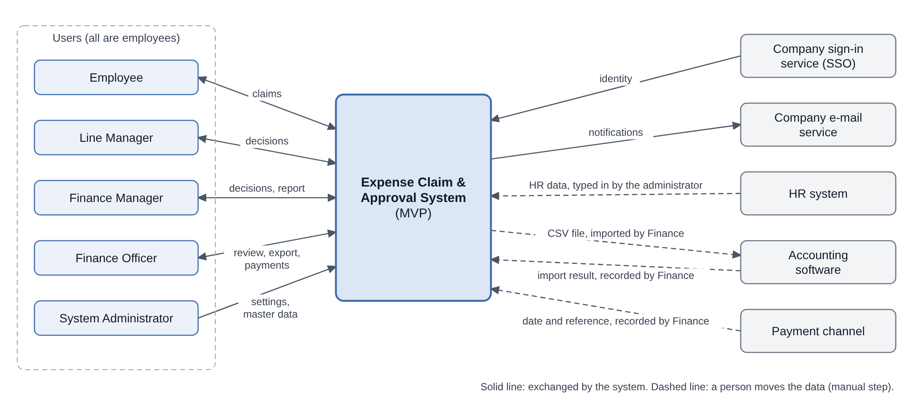

*Figure 8. System context*

## 5.2 Use Case Diagram

Figure 9 shows the ten use cases in Table 20 and, in the lower panel, how the actors relate. Each role is a specialised Employee, so it inherits UC-01, UC-02 and UC-07 for its own claims. The roles come from two sources. Line Manager is played through the reporting line, so an employee with any system role can also be a line manager. Finance Officer, Finance Manager and System Administrator are values of the one system role stored for each employee, so that generalization set is marked {incomplete, disjoint}: an employee holds at most one of them and may hold none. One system role per employee is a BA recommendation for the case study, and the System Administrator role gives no Finance permissions. Detailed permissions are in Table 28 and Table 29. The accounting software is not an actor because Finance imports the file by hand.

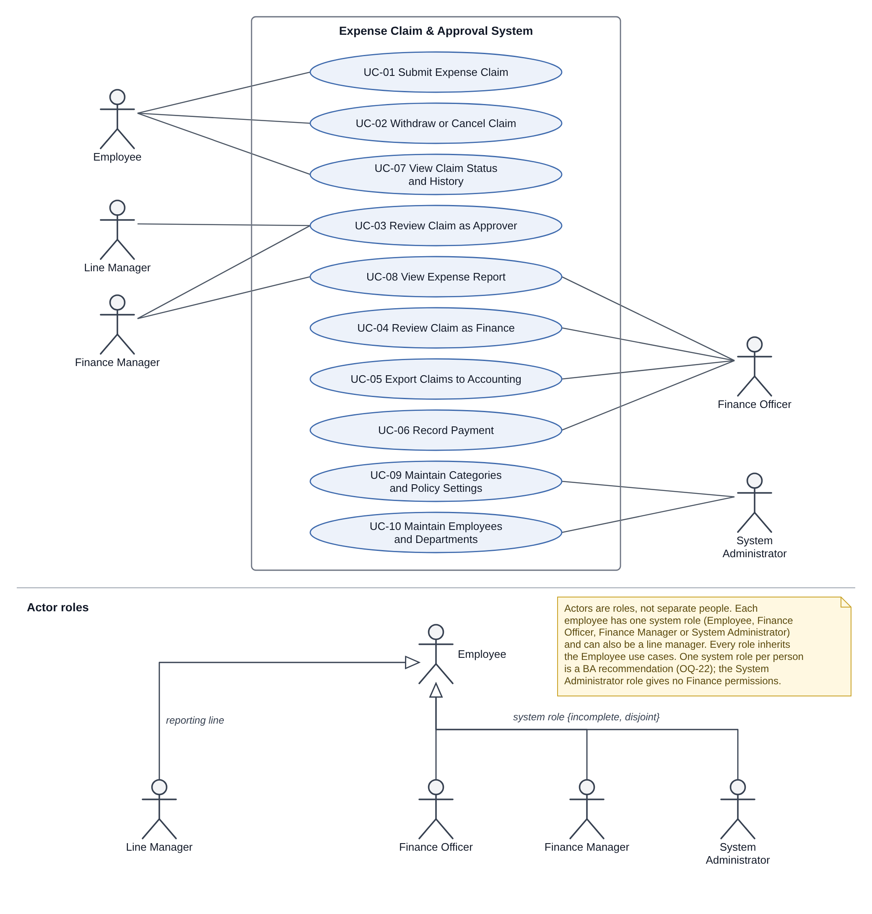

*Figure 9. Use case diagram and actor roles*

## 5.3 Activity Diagram

Figure 10 shows the main flow from claim to payment, with one partition (swimlane) for each role and one for the system. The submit checks find every blocking issue first; the duplicate confirmation comes only when none is left. After a Level 1 approval, when the route needs Level 2, the system assigns the Level 2 approver and e-mails them (step 6); the claim goes to Finance Review only after the last required level (Table 8). The connector R leads back to step 1 for correction, and the status names in italics show the claim or export status after a step. Withdrawal and cancellation are shown in the state diagram (§5.4).

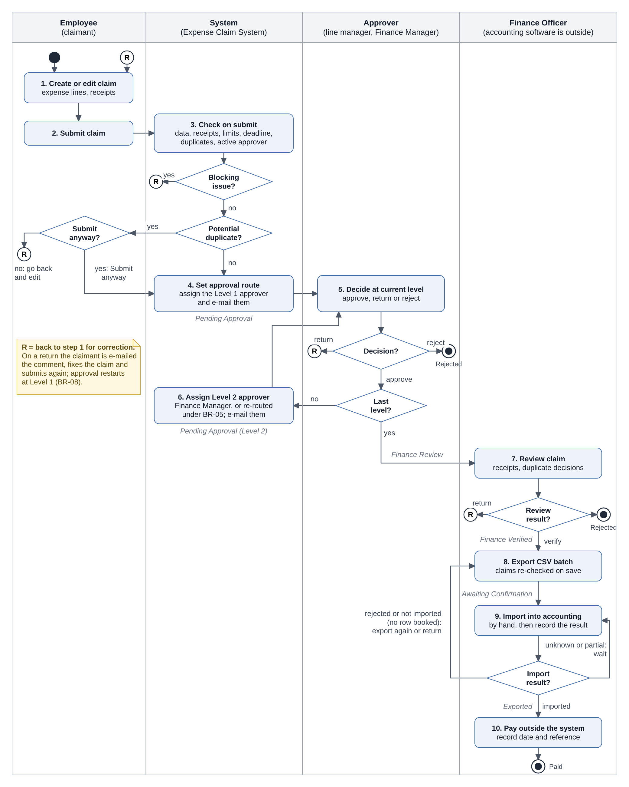

*Figure 10. Activity diagram: from claim to payment*

## 5.4 State Diagram

Figure 11 shows the eight claim statuses and the transitions in Table 8. Conditions are written in square brackets. Rejected, Cancelled and Paid are final.

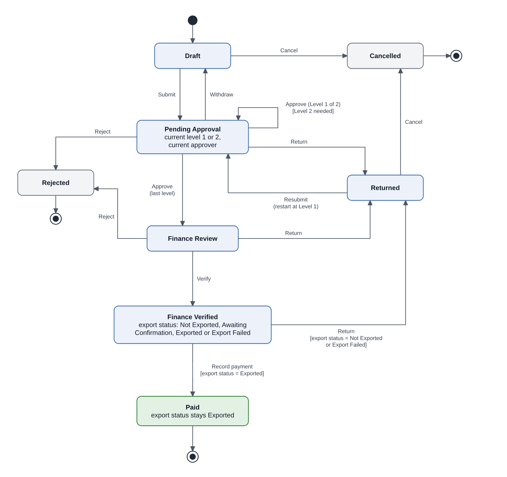

*Figure 11. Claim status state diagram*

# 6. External Interface Specifications

The MVP exchanges data with the accounting software through CSV files and uses the company sign-in and e-mail services. HR data are entered by hand. Apart from sign-in and outgoing e-mail, no interface is automated. The file layout and import behaviour in this chapter are assumptions until the accounting import template is reviewed.

## 6.1 Accounting CSV Export

*Table 32. Accounting export file*

| **Item**           | **Description**                                                                 |
|--------------------|---------------------------------------------------------------------------------|
| **Direction**      | Expense system → CSV file → accounting software, imported by a Finance Officer. |
| **Trigger**        | A Finance Officer generates an export batch.                                    |
| **Content**        | One row per expense line of each included claim; the columns are in §6.2.       |
| **File format**    | UTF-8, comma-separated, one header row.                                         |
| **File name**      | The batch ID, for example EXP-20261014-01.csv.                                  |
| **Storage**        | The file is stored with the batch and can be downloaded again (FR-10).          |
| **Identification** | Each row carries the batch ID, the claim ID and the line number.                |

## 6.2 Accounting Field Mapping and Validation

Table 33 shows where each column comes from and what happens when a value is missing. Which claims can be exported is defined in BR-11.

*Table 33. Accounting field mapping (assumed)*

| **Column**                                  | **Source**                                                           | **Required**     | **Rule**                                                                                      | **If missing or invalid**                                                                    |
|---------------------------------------------|----------------------------------------------------------------------|------------------|-----------------------------------------------------------------------------------------------|----------------------------------------------------------------------------------------------|
| **BatchRef**                                | Export batch ID                                                      | Yes              | Generated by the system.                                                                      | Cannot be missing.                                                                           |
| **DocRef, DocLine**                         | Claim ID; line number                                                | Yes              | Claim ID as stored, for example EC-2026-00012; lines numbered from 1 within each claim.       | Cannot be missing.                                                                           |
| **EmployeeCode**                            | Claimant’s employee ID                                               | Yes              | Used even if the employee has since left.                                                     | Not recognised by accounting: the claim is rejected at import (Export Failed).               |
| **TxnDate**                                 | Expense date                                                         | Yes              | DD/MM/YYYY                                                                                    | Cannot be missing.                                                                           |
| **AccountCode**                             | GL account code of the line’s category                               | Yes              | Looked up when the batch is saved.                                                            | Not set: the claim is left out with the reason. Not recognised by accounting: Export Failed. |
| **CostCenter**                              | Cost center code of the department stored on the claim at submission | Yes (to confirm) | The department is fixed at submission; its code is read when the batch is saved.              | Not set: the claim is left out with the reason. Not recognised by accounting: Export Failed. |
| **Amount**                                  | Line amount                                                          | Yes              | Whole number in VND, without separators.                                                      | Cannot be invalid: BR-01 is checked on submit.                                               |
| **Description**                             | Line description                                                     | Yes              | As entered, up to \[200\] characters; the length of the accounting column is to be confirmed. | Cannot be missing under BR-01.                                                               |
| **SellerTaxCode, InvoiceSymbol, InvoiceNo** | Invoice identifiers                                                  | No               | As entered.                                                                                   | Empty when not entered.                                                                      |
| **ApprovalRef**                             | Final approver’s employee ID and approval date                       | Yes              | Taken from the history; format to confirm.                                                    | Cannot be missing for an approved claim.                                                     |
| **VerifiedBy**                              | Employee ID of the Finance Officer who verified the claim            | Yes              | Taken from the history.                                                                       | Cannot be missing for a verified claim.                                                      |

## 6.3 Import Result Recording and Error Handling

Finance imports the file and checks the result in the accounting software. A Finance Officer who is not the claimant records it for each claim. Nothing is recorded automatically, and the claim stays Finance Verified in every case.

*Table 34. Import outcomes and Finance actions*

| **What Finance finds in the accounting software**                                                                          | **What Finance records**                                | **Export status**     | **What is allowed next**                                                                     |
|----------------------------------------------------------------------------------------------------------------------------|---------------------------------------------------------|-----------------------|----------------------------------------------------------------------------------------------|
| All rows of the claim were booked.                                                                                         | Imported                                                | Exported              | Record payment. No new export or return.                                                     |
| No row of the claim was booked: accounting rejected it, or it was not imported (for example, the file was never imported). | Rejected by accounting or Not imported, with the reason | Export Failed         | Fix the cause if needed and export again in a new batch, or return the claim. No payment.    |
| The result is not known yet.                                                                                               | Nothing                                                 | Awaiting Confirmation | No new export, return or payment. The batch stays in the list of batches that need a result. |
| Only some rows were booked (partial import).                                                                               | Nothing until reconciled                                | Awaiting Confirmation | No new export, return or payment until Finance has reconciled the claim (see below).         |

**Why a partial import is not Export Failed.** A claim may be exported again only if no row of it was booked; otherwise a second export could book the same expense twice. The design assumes that the accounting software accepts or rejects a claim as a whole (§2.6.1). If a partial import can happen, the proposal is that Finance first corrects the entry in the accounting software, then records Imported if all rows are booked or Rejected by accounting if no row remains booked. This has not been confirmed. Until it is, a partly imported claim cannot be paid through the system and stays in the list of batches that need a result.

**Batch traceability.** Each claim keeps a link to every batch it was in, with the recorded result and reason (Export Batch Claim, §7.2). The claim details show the latest batch ID and result, so a Paid claim shows the batch in which it was recorded as Imported. Earlier batches appear in the claim history.

## 6.4 Other External Interfaces (Business Level)

*Table 35. Other external interfaces*

| **External system**               | **Information exchanged**                                            | **Trigger**                                      | **In the MVP**                                                                 |
|-----------------------------------|----------------------------------------------------------------------|--------------------------------------------------|--------------------------------------------------------------------------------|
| **HR system**                     | Employee IDs, names, e-mail addresses, departments and line managers | The System Administrator enters changes.         | Entered by hand; no automatic sync. How HR reports changes is open.            |
| **Company e-mail service**        | Claim ID and link; return or rejection comment; payment date         | A claim is assigned, returned, rejected or paid. | Outgoing only. Sent after the action is saved; failures are logged; no retry.  |
| **Company sign-in service (SSO)** | User identity at sign-in                                             | Each sign-in                                     | Roles and active status stay in the expense system. Checked by IT outside UAT. |
| **Payment channel**               | Payment date and reference, typed in by Finance                      | Finance records a payment.                       | No connection; payment is made outside the system. The channel is open.        |

# 7. Data Requirements

This chapter defines the logical data that the business rules and interfaces need. It does not prescribe a physical database design.

## 7.1 Logical ERD

Figure 12 shows the main entities, keys and relationships in crow’s-foot notation. A Draft claim may have no expense lines yet. Policy Setting is a single system-wide record with no relationship to other entities. Each employee has one system role.

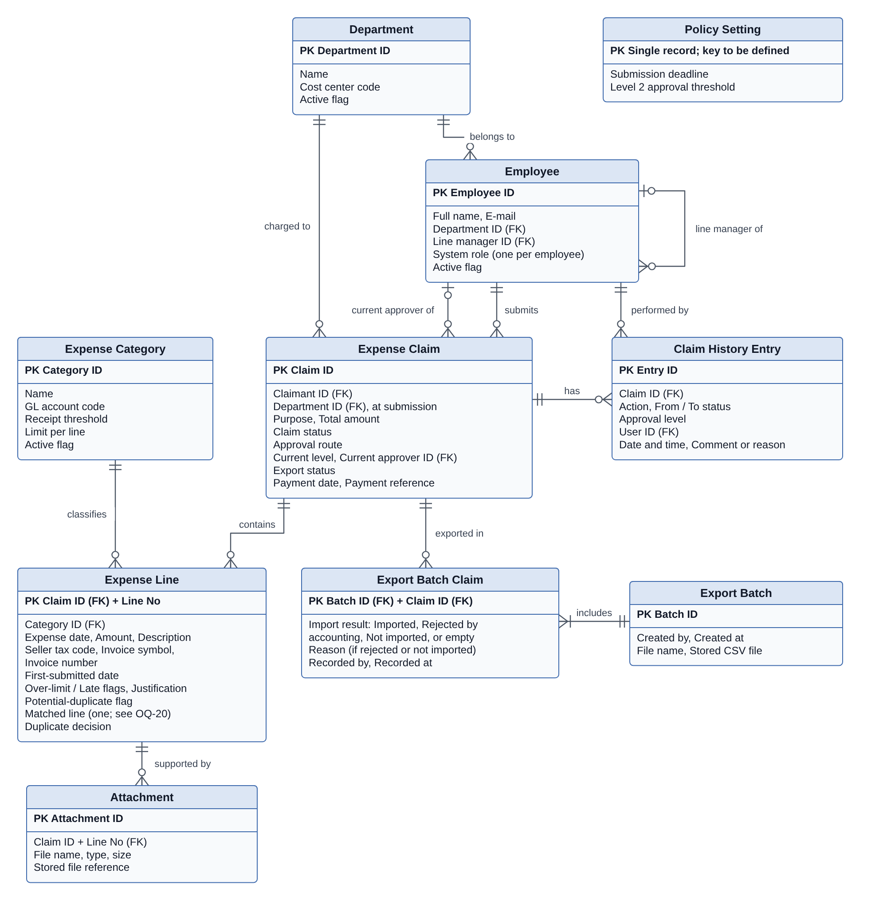

*Figure 12. Logical entity-relationship diagram*

## 7.2 Key Entities

Table 36 lists each entity of Figure 12 with its main data. Field formats and allowed values are defined once.

*Table 36. Key entities*

| **Entity**              | **Key**                | **Main data**                                                                                                                                            |
|-------------------------|------------------------|----------------------------------------------------------------------------------------------------------------------------------------------------------|
| **Department**          | Department ID          | Name, cost center code, active flag.                                                                                                                     |
| **Employee**            | Employee ID            | Name, e-mail, department, line manager, one system role, active flag.                                                                                    |
| **Expense Category**    | Category ID            | Name, GL account code, receipt threshold, limit per line, active flag.                                                                                   |
| **Expense Claim**       | Claim ID               | Claimant, department at submission, purpose, total, claim status, approval route, current level and approver, export status, payment date and reference. |
| **Expense Line**        | Claim ID + line number | Category, expense date, amount, description, invoice identifiers, first-submitted date, flags, justification, matched line, duplicate decision.          |
| **Attachment**          | Attachment ID          | Expense line, file name, type, size, stored file.                                                                                                        |
| **Claim History Entry** | Entry ID               | Claim, action, from and to status, approval level, user, date and time, comment or reason.                                                               |
| **Export Batch**        | Batch ID               | Created by, created at, file name, stored CSV file.                                                                                                      |
| **Export Batch Claim**  | Batch ID + Claim ID    | Import result, reason, recorded by and at.                                                                                                               |
| **Policy Setting**      | Single record          | Submission deadline, Level 2 threshold.                                                                                                                  |

If OQ-15 decides that the export must use the cost center code at submission, Expense Claim needs a new field, “cost center code at submission”, and the CostCenter row in Table 33 must read it.

## 7.3 Data Validation and Business Constraints

- Claim IDs and batch IDs are unique. Line numbers are unique within a claim and are not reused.

- The claim total always equals the sum of its line amounts.

- A claim is in at most one batch whose result has not been recorded.

- History entries are only added; they are never changed or deleted.

- Every reference to a category, employee, department or batch must point to an existing record.

# 8. Testing Requirements

## 8.1 Verification Approach

The requirements will be checked by UAT and by technical checks. The acceptance criteria in the Product Backlog are the basis for UAT test cases. No test has been run; this chapter describes the plan.

*Table 37. Planned checks*

| **Check**                     | **Who**                                          | **What it covers**                                                                                                                                                                                                                                                                |
|-------------------------------|--------------------------------------------------|-----------------------------------------------------------------------------------------------------------------------------------------------------------------------------------------------------------------------------------------------------------------------------------|
| **UAT**                       | Claimants, approvers and Finance, with test data | The flows in FR-01 to FR-16; what users see of permissions and history protection; messages; attachment rules.                                                                                                                                                                    |
| **Technical checks**          | IT/QA                                            | Direct requests outside the screens, including batch and import-result requests by the claimant or the System Administrator; SSO; protection of the stored history; simultaneous requests and all-or-nothing saving, including concurrent export; browser support; response time. |
| **Failure tests**             | IT/QA, in a test environment                     | File-generation failure and e-mail failure.                                                                                                                                                                                                                                       |
| **Blocked by open questions** | \-                                               | Retention; the performance target; the real CSV template and partial import.                                                                                                                                                                                                      |

## 8.2 Checks Outside UAT and Test Limitations

- **Accounting interface:** export tests use the assumed mapping in Table 33, not the real import template. They must be repeated when OQ-02 is answered, with a partial-import case if the accounting software allows partial imports.

- **UAT works through the screens only:** the technical checks in Table 37 are reported separately, and a UAT pass does not cover them.

- **Forced failures:** file-generation and e-mail failures need a test environment and a method agreed with IT/QA.

- **Unconfirmed values:** the bracketed settings are illustrative. Tests that use them must be reviewed when OQ-05 and OQ-06 are answered.

# 9. Appendix

## Appendix A: Decision Log

This log keeps the decisions that involve a significant trade-off. Each stays provisional until the linked open question is answered. A decision marked BA recommendation was made to complete the case study; it is not a stakeholder decision and must be confirmed in a real project. Smaller choices are recorded in the business rules and open questions themselves.

*Table 38. Decision log*

| **Decision**                                              | **Options considered**                                                                                       | **Chosen (provisional)**                                                                                                                                                                                                                                   | **Trade-off accepted**                                                                                                                                                             | **Revisit if**                                                             |
|-----------------------------------------------------------|--------------------------------------------------------------------------------------------------------------|------------------------------------------------------------------------------------------------------------------------------------------------------------------------------------------------------------------------------------------------------------|------------------------------------------------------------------------------------------------------------------------------------------------------------------------------------|----------------------------------------------------------------------------|
| **Solution approach**                                     | Improve Excel and e-mail; configure an expense product; build a custom web app                               | Fit-gap one or two products first; build only if a Must requirement cannot be met                                                                                                                                                                          | A faster start with a proven workflow, against less control over the CSV layout and the status model                                                                               | The import template or IT rules out products                               |
| **Claim status and export status**                        | One status list that includes “Exported”; two separate fields                                                | Two fields, with Awaiting Confirmation for an unknown result                                                                                                                                                                                               | One more field for users to read, so that an unknown import result never looks like success                                                                                        | A direct integration confirms results automatically                        |
| **Potential duplicates**                                  | Block the claim; flag silently for Finance; warn and ask the claimant to confirm                             | Warn, offer “Submit anyway” once nothing else blocks, then a Finance decision                                                                                                                                                                              | Extra steps for genuine repeats, so that mistakes are caught before approval while Finance keeps control                                                                           | Genuine repeats are flagged too often                                      |
| **Accounting interface**                                  | API integration; CSV file imported by Finance                                                                | CSV file, with the result recorded per claim                                                                                                                                                                                                               | Manual import and result recording for Finance, against no dependency on an unknown API                                                                                            | The template or an API changes what is possible                            |
| **Partial import**                                        | Treat as Export Failed; treat as Imported; keep waiting                                                      | Keep Awaiting Confirmation until Finance has reconciled it                                                                                                                                                                                                 | The claim cannot be paid through the system until it is reconciled, but no row can be booked twice                                                                                 | Finance confirms how partial imports are corrected                         |
| **How permissions combine**                               | System role only; system role plus the user’s relationship to the claim                                      | Claimant and assigned-approver permissions added to one system role                                                                                                                                                                                        | A line manager can hold any system role, but one person may act in two steps of another person’s claim                                                                             | Finance or IT restrict combined roles                                      |
| **Import results and role conflicts (BA recommendation)** | Any Finance Officer records any result; also let the System Administrator record results; exclude own claims | Only a Finance Officer records import results, never for a claim they submitted, even if another Finance Officer exported it. The System Administrator role gives no Finance permissions. One system role per employee; refuse the action on any conflict. | A second Finance Officer must always be available for Finance Officers’ own claims, and IT cannot help record results. In return, nobody confirms that their own claim was booked. | Stakeholders allow several roles per person or want IT support for results |
| **Same person at both levels**                            | One approval; send Level 2 to that person’s manager; name a deputy                                           | One approval completes both levels                                                                                                                                                                                                                         | Simpler routing, without an independent second approval                                                                                                                            | An independent second approval is required                                 |
| **E-mail priority**                                       | Should; Must                                                                                                 | Must                                                                                                                                                                                                                                                       | The first release depends on the e-mail service, but claims do not wait unnoticed                                                                                                  | Finance and IT agree on another priority                                   |

## Appendix B: Open Questions

No stakeholder has answered these questions. The Elicitation Plan shows how they will be asked. **Status:** *Open* means there is no answer; the SRS may already apply a provisional rule, described in the impact column. *Settled for the case study* means a BA recommendation (Appendix A) is applied so that the case study is complete; it is not a stakeholder answer and must be confirmed in a real project. The last column proposes when an answer is needed: **Baseline** means before this SRS is approved as the requirements baseline; **Build** means before the named function or data is designed and built; **UAT**, **performance test** and **go-live** mean before that activity. These timings are proposals for the project plan, not stakeholder decisions.

*Table 39. Open questions*

| **ID**    | **Question**                                                                                                                                                                                                                                                                                             | **Ask**                                      | **Status**                    | **Needed before**                  |
|-----------|----------------------------------------------------------------------------------------------------------------------------------------------------------------------------------------------------------------------------------------------------------------------------------------------------------|----------------------------------------------|-------------------------------|------------------------------------|
| **OQ-01** | **High priority.** Who approves claims of the Finance Manager and senior managers? When one person holds both levels, is one approval enough? The General Director has no line manager in the data, so their own claims would be blocked.                                                                | CFO, Finance Manager                         | Open                          | Baseline                           |
| **OQ-02** | Which file, columns, formats and field lengths does the accounting software need? Can it book only part of a claim? How are results reported, and how is an entry corrected after it has been booked?                                                                                                    | Finance Officers, IT                         | Open                          | Baseline                           |
| **OQ-03** | Does Finance pay through the accounting software or internet banking, and before or after the claim is booked?                                                                                                                                                                                           | Finance Manager                              | Open                          | Build (FR-11)                      |
| **OQ-04** | Which invoice details identify the same invoice? How common are receipts without them? How often would check B flag genuine repeats, such as the same taxi fare twice in one day?                                                                                                                        | Finance Officers                             | Open                          | Build (BR-10)                      |
| **OQ-05** | Are limits, receipt thresholds and the deadline written in company policy? Should over-limit or late lines be blocked instead of justified? Is Late counted from the first or the latest submission?                                                                                                     | Finance Manager                              | Open                          | Build (BR-02, BR-03)               |
| **OQ-06** | Is the Level 2 threshold checked per claim or across related claims, such as one business trip?                                                                                                                                                                                                          | Finance Manager, line managers               | Open                          | Build (BR-04)                      |
| **OQ-07** | Should a resubmitted claim go back to the level that returned it instead of Level 1?                                                                                                                                                                                                                     | Line managers, Finance Manager               | Open                          | Build (BR-08)                      |
| **OQ-08** | Who maintains employee and line-manager data, and how does HR report changes? How should open claims be handled when a claimant or an approver leaves? The workaround for a claim waiting for an approver who has left relies on withdrawal (FR-04, Should): should FR-04 be Must?                       | HR, Finance Manager                          | Open                          | Baseline                           |
| **OQ-09** | Must paper receipts or original e-invoice files still be kept after go-live? How long must claims, receipts and history be kept?                                                                                                                                                                         | Finance Manager                              | Open                          | Baseline (scope); go-live (period) |
| **OQ-10** | Is a commercial expense product acceptable in cost, data hosting and IT approval?                                                                                                                                                                                                                        | CFO, IT                                      | Open                          | Build-or-buy decision              |
| **OQ-11** | Are the assumed problems real, and what are the current values of the success measures? Is the spending report (FR-14) enough to replace the monthly summary?                                                                                                                                            | Employees, Finance Officers, Finance Manager | Open                          | Setting targets; not blocking      |
| **OQ-12** | Do sales staff need to submit claims or receipt photos on a phone?                                                                                                                                                                                                                                       | Employees, line managers                     | Open                          | Baseline                           |
| **OQ-13** | Should lines in Draft and Returned claims be compared in the duplicate check, or only lines in claims that have been submitted?                                                                                                                                                                          | Finance Officers                             | Open                          | Build (BR-10)                      |
| **OQ-14** | When a limit, receipt threshold, deadline, category or the Level 2 threshold changes, should claims already submitted be re-checked, or should the new values apply only on submission or resubmission? In particular, may a Returned claim keep a category that was deactivated after it was submitted? | Finance Manager                              | Open                          | Build (BR-09, FR-15)               |
| **OQ-15** | If a department’s cost center code changes after a claim is submitted, should the export use the code at submission or the code at export?                                                                                                                                                               | Finance Officers, Finance Manager            | Open                          | Build (export mapping)             |
| **OQ-16** | What response time does IT accept for claim lists and details, and how and where should it be measured?                                                                                                                                                                                                  | IT                                           | Open                          | Performance test                   |
| **OQ-17** | How should claims still in the Excel and e-mail process at go-live be finished, and from what date must new claims use the system?                                                                                                                                                                       | Finance Manager                              | Open                          | Go-live                            |
| **OQ-18** | Must changes to roles, line managers, categories, GL and cost center codes and policy settings be traceable (who changed what, and when)?                                                                                                                                                                | Finance Manager, IT                          | Open                          | Baseline                           |
| **OQ-19** | May one person act in two steps of the same claim, for example approve it as line manager and then verify, export, record the import result or pay it as Finance Officer? May a System Administrator, who maintains line-manager data, also be an approver?                                              | CFO, Finance Manager, IT                     | Partly settled for case study | Baseline                           |
| **OQ-20** | When a line matches more than one other line, should approvers and Finance see every match or only one, and if only one, which?                                                                                                                                                                          | Finance Officers                             | Open                          | Build (BR-10, data model); UAT     |
| **OQ-21** | Must every claim have a purpose before it can be submitted, and is there a length limit?                                                                                                                                                                                                                 | Finance Manager                              | Open                          | Build (FR-02)                      |
| **OQ-22** | May one employee hold more than one system role, for example Finance Officer and System Administrator? If so, which combinations are allowed?                                                                                                                                                            | CFO, Finance Manager, IT                     | Settled for case study        | Baseline (confirm)                 |
